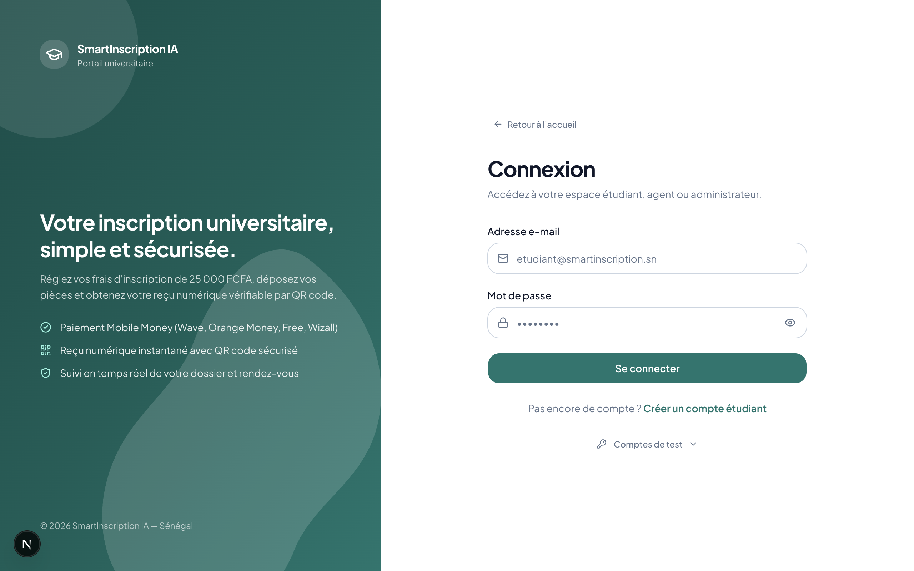
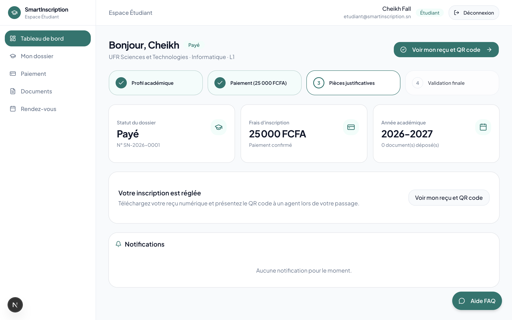
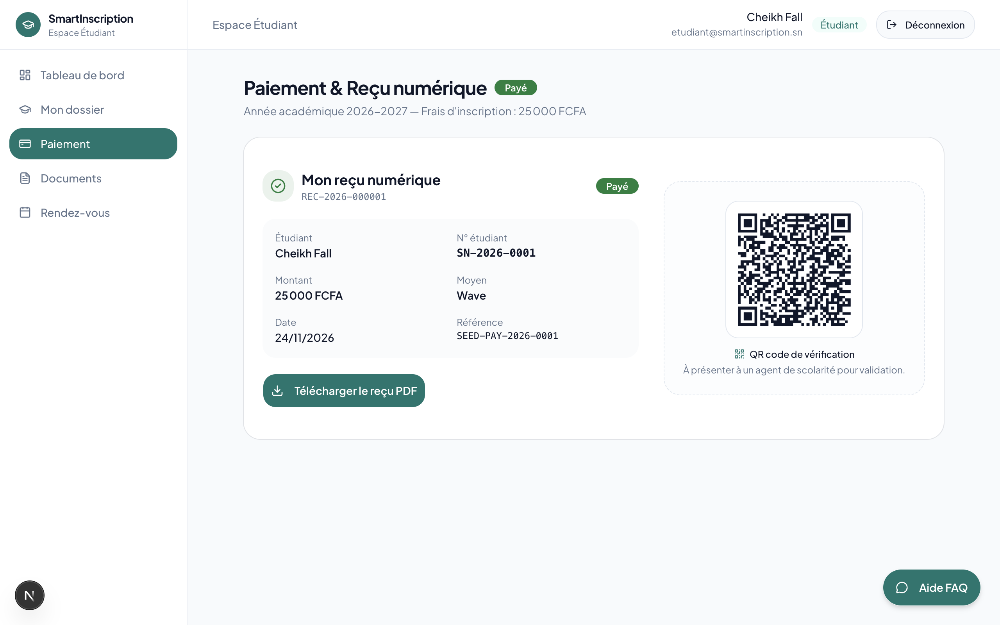
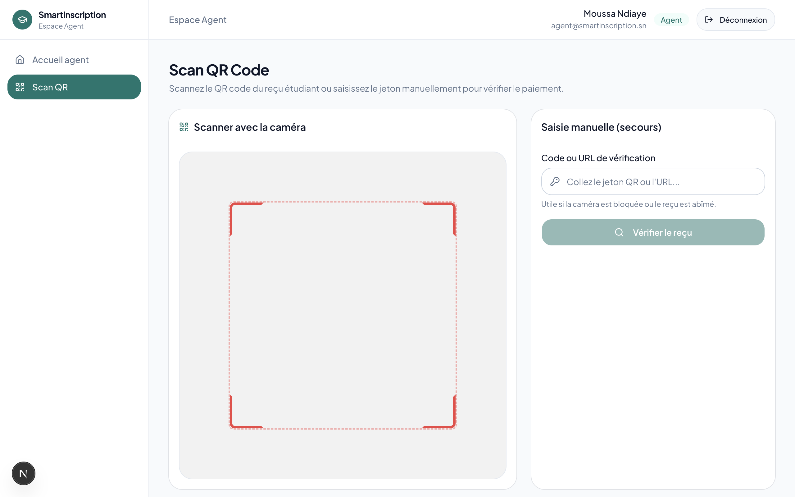
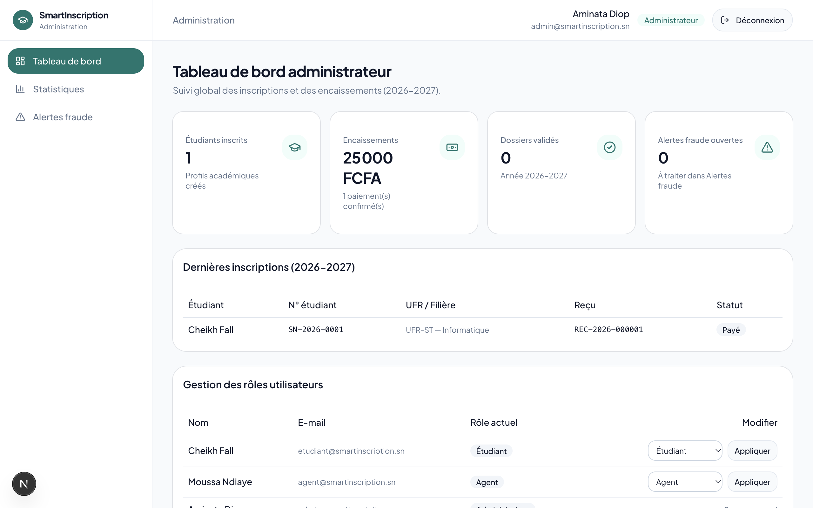

# SmartInscription IA

Plateforme web et mobile (PWA) de paiement et de gestion des inscriptions universitaires au Sénégal (frais de 25 000 FCFA, reçu numérique, QR code, scan par un agent, rendez-vous, tableau de bord administrateur et module IA).

## Aperçu de la plateforme

### Page d'accueil & Connexion
| Accueil | Connexion |
| --- | --- |
|  |  |

### Espace Étudiant (Tableau de bord & Reçu QR)
| Tableau de bord étudiant | Reçu numérique & QR Code |
| --- | --- |
|  |  |

### Espace Agent & Administration
| Scan QR Agent | Tableau de bord Administrateur |
| --- | --- |
|  |  |

## Prérequis

- **Node.js** >= 20
- **pnpm** >= 9 (`npm install -g pnpm`)
- **Python** >= 3.9 (ou **Docker & Docker Compose** pour le service IA FastAPI et PostgreSQL local)
- Un projet **Supabase** (pour l'authentification, le stockage privé et la base PostgreSQL)

## Installation en 5 étapes

1. **Cloner le dépôt et basculer sur `dev`**
   ```bash
   git clone https://github.com/ona79/smartinscription.git
   cd smartinscription
   git checkout dev
   ```

2. **Installer les dépendances du monorepo et compiler `@smartinscription/shared`**
   ```bash
   pnpm install
   pnpm --filter @smartinscription/shared build
   ```

3. **Configurer les variables d'environnement**
   ```bash
   cp .env.example .env
   ln -sf ../../.env apps/web/.env
   ```
   Renseigner ensuite `DATABASE_URL`, `DIRECT_URL`, `NEXT_PUBLIC_SUPABASE_URL`, `NEXT_PUBLIC_SUPABASE_ANON_KEY` et `SUPABASE_SERVICE_ROLE_KEY` dans `.env` (ainsi que `PAYMENT_PROVIDER`, `PAYTECH_*` ou `RESEND_API_KEY` selon besoin).

4. **Lancer le service IA (optionnel en local)**
   ```bash
   cd services/ia
   python3 -m venv .venv
   .venv/bin/pip install -r requirements.txt
   .venv/bin/uvicorn main:app --reload --port 8000
   ```
   *(Ou via Docker : `docker compose up -d`)*

5. **Générer Prisma, appliquer les migrations et injecter les données initiales**
   ```bash
   pnpm db:generate
   pnpm --filter @smartinscription/web exec prisma migrate deploy
   pnpm db:seed
   ```
   *(Note : le seed est bloqué si `NODE_ENV=production` sauf `SEED_ALLOW_PROD=true`. Les mots de passe des comptes seedés sont configurables via `SEED_ADMIN_PASSWORD`, `SEED_AGENT_PASSWORD` et `SEED_STUDENT_PASSWORD`.)*

## Commandes principales

| Commande | Description |
| --- | --- |
| `pnpm dev` | Lance l'application Next.js en mode développement (`http://localhost:3000`) |
| `pnpm build` | Compile `@smartinscription/shared` et `apps/web` pour la production |
| `pnpm lint` | Vérifie le code (ESLint + TypeScript) sur tout le monorepo |
| `pnpm test` | Exécute les tests unitaires Vitest (`apps/web`) |
| `pnpm format` | Formate le code avec Prettier |
| `pnpm db:generate` | Génère le client Prisma |
| `pnpm db:migrate` | Crée/exécute les migrations Prisma (`prisma migrate dev`) |
| `pnpm db:seed` | Exécute le script de seed (`apps/web/prisma/seed.ts`) |
| `pnpm db:seed:demo` | Génère ~300 étudiants synthétiques `demo.*` (idempotent, protégé en production) |
| `pnpm db:seed:demo:reset` | Supprime uniquement les données de démonstration `demo.*` |
| `pnpm db:studio` | Ouvre Prisma Studio |

## Structure du dépôt

```text
smartinscription/
├── apps/
│   └── web/                 # Application Next.js (App Router, Tailwind, shadcn/ui, Prisma, PWA)
├── services/
│   └── ia/                  # Microservice FastAPI (prédiction affluence/personnel, anomalies, chatbot FAQ)
├── packages/
│   └── shared/              # Constantes, machine à états et types partagés
├── docs/
│   ├── architecture.md      # Architecture technique et flux de paiement/QR
│   ├── base-de-donnees.md   # Modèles Prisma et relations
│   ├── conventions.md       # Conventions de code, features/<bloc>, Git & PR
│   └── design-system.md     # Tokens CSS et composants réutilisables
├── docker-compose.yml       # PostgreSQL local + service IA
├── .env.example             # Modèle des variables d'environnement
└── pnpm-workspace.yaml      # Configuration des workspaces pnpm
```

## Documentation équipe

Avant de commencer une fonctionnalité, lire :
- [docs/conventions.md](docs/conventions.md)
- [docs/architecture.md](docs/architecture.md)
- [docs/base-de-donnees.md](docs/base-de-donnees.md)
- [docs/design-system.md](docs/design-system.md)
